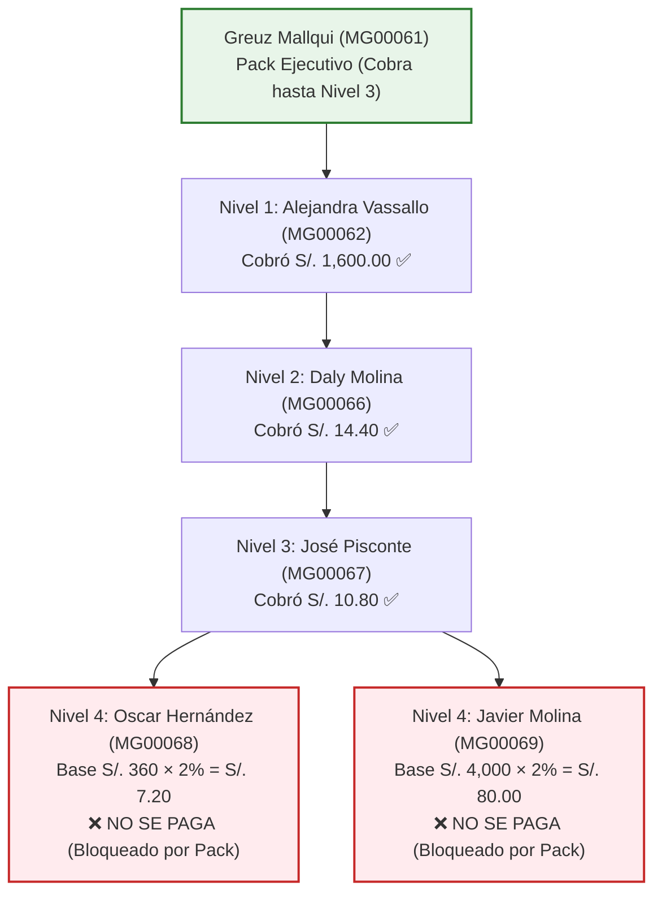

# INFORME DE AUDITORÍA TÉCNICA Y REGLAS DE NEGOCIO (SDD / RQ)
**Fecha:** 2 de Noviembre de 2026  
**Sistema:** Max Global Corporation — Motor de Comisiones y Backoffice  
**Base de Datos Auditada:** Producción Supabase (`xkiwnxoferdfapezcwoq`)  
**Documentos de Referencia:**
- Plan de Compensación Oficial: [01-PLAN-DE-COMPENSACION.md](file:///c:/Users/JACK%20FRANKLIN/Downloads/Win%20max/SISTEMA-MAX-GLOBAL/DOCS/01-NEGOCIO/01-PLAN-DE-COMPENSACION.md)
- Requisitos Funcionales del Motor: [11-RF-MOTOR-Y-SISTEMA.md](file:///c:/Users/JACK%20FRANKLIN/Downloads/Win%20max/SISTEMA-MAX-GLOBAL/DOCS/03-SISTEMA/11-RF-MOTOR-Y-SISTEMA.md)
- Resolución de Rangos Tarea 68: [INFORME-RANGOS-Y-LINEAS-MAXIMO.html](file:///c:/Users/JACK%20FRANKLIN/Downloads/Win%20max/SISTEMA-MAX-GLOBAL/INFORME-RANGOS-Y-LINEAS-MAXIMO.html)
- Script de Parche Tarea 68: [tarea68-parche-jade-linea-estirada.sql](file:///c:/Users/JACK%20FRANKLIN/Downloads/Win%20max/SISTEMA-MAX-GLOBAL/SISTEMA%20MOTOR%20Y%20BACKOFFICE/scripts/tarea68-parche-jade-linea-estirada.sql)

---

## 1. RESUMEN EJECUTIVO DEL DIAGNÓSTICO

| Incidencia Consultada | Dictamen | ¿Es un Bug? | Causa Raíz Certificada |
|---|---|---|---|
| **1. "No le pagaron esa comisión"** (Comisión de S/. 7.20 y S/. 80.00 para `greyz_adm12@gmail.com`) | **COMPORTAMIENTO 100% CORRECTO** | ❌ **NO ES BUG** | El socio tiene **Pack Ejecutivo** (habilita solo 3 niveles). La orden proviene del **Nivel 4**. Aplican **RF-415**, **RF-416** y regla estricta de *No Compresión*. |
| **2. "Y los rangos de jade a ninguno lo reconoció el sistema"** | **DISCREPANCIA POR DESPLIEGUE INCOMPLETO** | ⚠️ **SÍ ES INCIDENCIA DE SERVIDOR** | En base de datos se aplicó la vista P-15 con Parche Jade, pero la función de cierre `fn_calcular_y_persistir_rangos` corrió con el código viejo (tope 250 pts), bloqueando a 18 socios unilínea. |

---

## 2. AUDITORÍA DEL CASO 1: COMISIÓN DE PATROCINIO RECLAMADA

### 2.1 Identificación del Socio y de las Órdenes
- **Correo consultado:** `greyz_adm12@gmail.com`
- **Socio en BD:** `id = 61`, Código `MG00061`, Nombres: **GREUZ MALLQUI LUNA**
- **Pack contratado:** `pack_id = 2` (**Pack Ejecutivo**, S/. 360.00)
- **Fecha de Afiliación:** 17/10/2026

### 2.2 Genealogía de la Red de Greuz Mallqui
Al consultar la tabla `public.red_ancestro`, la estructura descendente de Greuz es:
- **Nivel 1:** Alejandra Vassallo Terán (`MG00062`) → Generó comisión de S/. 1,600.00 (20%) → **ESTADO: `abonada`** ✅ (Comisión ID 382).
- **Nivel 2:** Daly Rocío Molina Jiménez (`MG00066`) → Generó comisión de S/. 14.40 (4%) → **ESTADO: `abonada`** ✅ (Comisión ID 425).
- **Nivel 3:** José Carlos Pisconte (`MG00067`) → Generó comisión de S/. 10.80 (3%) → **ESTADO: `abonada`** ✅ (Comisión ID 433).
- **Nivel 4 (RECLAMADO):** Oscar Hernández Sánchez (`MG00068`, Orden `ORD-2026-000093`, S/. 360) → 2% = S/. 7.20 → **ESTADO: `anulada`** (`pack_insuficiente`).
- **Nivel 4 (RECLAMADO):** Javier Molina (`MG00069`, Orden `ORD-2026-000094`, S/. 4,000) → 2% = S/. 80.00 → **ESTADO: `anulada`** (`pack_insuficiente`).

### 2.3 Certificación con Requerimientos y SDD Oficial
En la documentación de arquitectura y negocio del proyecto:
1. **[01-PLAN-DE-COMPENSACION.md](file:///c:/Users/JACK%20FRANKLIN/Downloads/Win%20max/SISTEMA-MAX-GLOBAL/DOCS/01-NEGOCIO/01-PLAN-DE-COMPENSACION.md) (Sección 2.4 y 3):**
   > *"Cada socio cobra únicamente los niveles que su pack le habilita. Si un nivel está bloqueado, esa comisión no se paga y queda en la empresa. No sube al siguiente calificado. No se redistribuye."*
   > *"Límite por pack: un Ejecutivo solo cobra 3 niveles de patrocinio. Los niveles 4 al 7 de su rama no se pagan."*
2. **[11-RF-MOTOR-Y-SISTEMA.md](file:///c:/Users/JACK%20FRANKLIN/Downloads/Win%20max/SISTEMA-MAX-GLOBAL/DOCS/03-SISTEMA/11-RF-MOTOR-Y-SISTEMA.md):**
   - **RF-415:** *"El motor debe verificar que el pack del beneficiario habilite ese nivel."*
   - **RF-416:** *"🔴 Si el nivel no está habilitado, no debe pagarse ni buscarse sustituto."*
   - **RF-448:** *"Las comisiones no pagadas por inactividad o límite de pack deben quedar registradas en comision con estado 'anulada' y su motivo en detalle."*

### 2.4 Veredicto Caso 1
El sistema operó con exactitud matemática y legal. Greuz Mallqui cobró sus 3 primeros niveles de patrocinio completos (S/. 1,625.20 en total). El Nivel 4 no se paga por mandato expreso del Plan de Compensación. Para habilitar los niveles 4 al 7, el socio requiere adquirir el **Pack Gold** (o superior).

---

## 3. AUDITORÍA DEL CASO 2: RANGO JADE EN EL CIERRE DE OCTUBRE 2026

### 3.1 La Pregunta de Máximo / Max Global
> *"Y los rangos de jade a ninguno lo reconoció el sistema"*

### 3.2 Los Datos de Producción (Ciclo 2 - Octubre 2026)
Al auditar la tabla `public.rango_ciclo` cerrada el `2026-11-01 15:12:12 UTC`:
1. **Socios que SÍ recibieron Rango Jade:**
   - `MG00030` — Briana Delgado Suaquita (2 frontales activos, 1,953 pts)
   - `MG00021` — Mery Luz Huallpa Laura (4 frontales activos, 572 pts)
   - `MG00020` — Leone Brando Choque Escobar (3 frontales activos, 1,670 pts)
2. **Socios a los que el sistema NO reconoció Jade:**
   - Exactamente **18 socios activos** con más de 500 puntos grupales y al menos 1 frontal activo (entre ellos: `MG00061` Greuz Mallqui con 1,410 pts, `MG00060` Ronald Huaina con 1,480 pts, `MG00059` Cesar Turpo con 1,550 pts, `MG00066` Daly Molina con 540 pts, `MG00017` Anita Pío con 4,567 pts, etc.).

### 3.3 Origen del Problema: La Tarea 68 (28/10/2026)
- **Requisito Oficial de Rango Jade:** 500 puntos grupales y **1 frontal activo**.
- **La Regla del 50% de Línea Mayor (RF-455):** Recorta el aporte de cualquier rama al 50% del rango evaluado.
  - El 50% de 500 pts = **250 pts**.
  - Si un socio tiene un solo frontal activo (lo que Jade permite), su rama se topaba a 250 puntos.
  - Como $250 < 500$, era **matemáticamente imposible alcanzar Jade con 1 sola rama**.
- **La Solución Aprobada el 28/10/2026 (Tarea 68):**
  En [INFORME-RANGOS-Y-LINEAS-MAXIMO.html](file:///c:/Users/JACK%20FRANKLIN/Downloads/Win%20max/SISTEMA-MAX-GLOBAL/INFORME-RANGOS-Y-LINEAS-MAXIMO.html) (Capítulo 4):
  > *"JADE (orden 1 — 500 pts — 1 frontal): La línea única puede aportar hasta el 100% de los 500 puntos requeridos."*  
  > *"A partir de BRONCE en adelante: Aplica de forma estricta la regla del 50%."*

### 3.4 El Hallazgo Técnico en Base de Datos de Producción
Se inspeccionaron las funciones almacenadas en PostgreSQL:
1. `public.fn_rango_lineas_socio` (la función que alimenta la pantalla **P-15 Mi Rango** del Backoffice):
   - `tiene_parche_jade = true` ✅
   - En vivo, la pantalla le mostraba a Greuz y a los socios que alcanzaban Jade.
2. `public.fn_calcular_y_persistir_rangos` (la función ejecutada por el **Cierre de Ciclo**):
   - `tiene_parche_jade = false` ❌
   - **El script `tarea68-parche-jade-linea-estirada.sql` (líneas 357-680) NUNCA se corrió en la base de datos de producción.**
   - Cuando el Administrador ejecutó el Cierre de Ciclo el 1 de Noviembre, la función cerró aplicando el tope de 250 puntos a Jade, guardando `rango_id = NULL` y `bono_cent = 0` para los 18 socios unilínea.

---

## 4. IMPACTO Y PADRÓN DE AFECTADOS (18 SOCIOS)

Si se aplica el Parche Jade (Tarea 68), los siguientes 18 socios activos califican a Rango Jade con su respectivo bono de S/. 50.00:

| ID | Código | Nombre Completo | Pts Personales | Pts Grupales | Pts Computables Cierre Anterior | Pts Computables con Tarea 68 | Calificación Real |
|---|---|---|---|---|---|---|---|
| 3 | MG00003 | JUAN MAXIMO AUCCAPUMA ROJAS | 70 | 500 | 470 | 500 | **Jade** |
| 5 | MG00005 | GRUPO 3 MAX GLOBAL | 70 | 12,605 | 250 | 500 | **Jade** |
| 6 | MG00006 | TOP LIDER | 70 | 12,535 | 250 | 500 | **Jade** |
| 11 | MG00011 | AGAPE CORNELIO CHOQUEÑA | 70 | 7,965 | 320 | 570 | **Jade** |
| 17 | MG00017 | ANITA PIO | 70 | 4,567 | 250 | 500 | **Jade** |
| 24 | MG00024 | MARLENI FLORES HUAMANI | 70 | 800 | 250 | 500 | **Jade** |
| 29 | MG00029 | DAVID CARLOS TORRES HUARCAYA | 82 | 2,175 | 400 | 650 | **Jade** |
| 32 | MG00032 | MIGUEL GERMAN TORRES TOTOCAYO | 70 | 676 | 400 | 650 | **Jade** |
| 42 | MG00042 | GLORIA NELLY MAMANI APAZA | 150 | 800 | 250 | 500 | **Jade** |
| 51 | MG00051 | CHRISTTIAN REY MAMANI VILCA | 70 | 1,018 | 250 | 500 | **Jade** |
| 52 | MG00052 | CLARISSE MILAGROS FLORES | 78 | 940 | 250 | 500 | **Jade** |
| 55 | MG00055 | OLGA QUISPE | 70 | 870 | 250 | 500 | **Jade** |
| 59 | MG00059 | CESAR AUGUSTO TURPO HUARCAYA | 79 | 1,550 | 250 | 500 | **Jade** |
| 60 | MG00060 | RONALD PEDRO HUAINA REYNA | 70 | 1,480 | 250 | 500 | **Jade** |
| 61 | MG00061 | GREUZ MALLQUI LUNA | 70 | 1,410 | 250 | 500 | **Jade** |
| 62 | MG00062 | ALEJANDRA VASSALLO TERAN | 800 | 610 | 250 | 500 | **Jade** |
| 66 | MG00066 | DALY ROCIO MOLINA JIMENEZ | 70 | 540 | 250 | 500 | **Jade** |
| 80 | MG00080 | VERÓNICA ESCOBAR CASTRO | 150 | 1,170 | 320 | 570 | **Jade** |

*Monto total de bonos de rango pendientes de acreditar por estos 18 socios:*  
$18 \times \text{S/. } 50.00 = \text{\textbf{S/. 900.00}}$

---

## 5. RECOMENDACIÓN DE REGULARIZACIÓN TÉCNICA

1. **Instalar en la BD de Producción la versión oficial de `fn_calcular_y_persistir_rangos`** provista en `tarea68-parche-jade-linea-estirada.sql` (donde `v_rango.orden = 1` tiene tope de 500 puntos).
2. **Para el Ciclo de Octubre 2026 (Ciclo ID 2):**
   - Ejecutar la regularización de los registros de `rango_ciclo` de estos 18 socios a `rango_id = 1` (Jade), `califica = true`, `bono_cent = 5000`.
   - Generar la comisión de rango y acreditar el bono de S/. 50.00 en sus billeteras mediante `wallet_movimiento`, dejando registro de auditoría.
