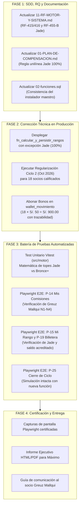

# PLAN DE ACCIÓN PROFESIONAL: CORRECCIÓN Y CERTIFICACIÓN INTEGRAL DE COMISIONES Y RANGOS
**Proyecto:** Max Global Corporation — Motor de Comisiones, Backoffice y Base de Datos  
**Estado:** Propuesta de Plan Integral para Aprobación  
**Responsable Técnico:** Antigravity AI (Pair Programming con Jack Franklin)  
**Fecha:** 3 de Noviembre de 2026  

---

## 1. OBJETIVO DEL PLAN

Resolver de forma definitiva, transparente y documentada las dos incidencias planteadas por Máximo / Max Global Corporation:
1. **Comisión de Patrocinio Reclamada por Greuz Mallqui (`greyz_adm12@gmail.com` / `MG00061`):**  
   Demostrar y certificar documentalmente que **no es un bug**, sino la aplicación de la regla de *No Compresión* y el límite de profundidad del **Pack Ejecutivo** (hasta Nivel 3). Generar la evidencia y el soporte visual para que la empresa comunique con total solidez al socio.
2. **Reconocimiento del Rango Jade en Estructuras Unilínea:**  
   Corregir la omisión técnica en producción donde la función de Cierre de Ciclo (`fn_calcular_y_persistir_rangos`) no tenía implementada la excepción de la Tarea 68 (Jade 100% computable en su única línea). Regularizar de forma segura e idempotente a los **18 socios calificados del ciclo de Octubre 2026**, abonando su bono de S/. 50.00 en billetera sin afectar ningún otro cálculo contable.
3. **Certificación Automatizada de Extremo a Extremo (E2E):**  
   Diseñar y ejecutar pruebas con **Vitest** y **Playwright** en vistas móviles (390px) y de escritorio para P-14 (Mis Comisiones), P-15 (Mi Rango), P-19 (Mi Billetera) y P-25 (Cierre de Ciclo).

---

## 2. ARQUITECTURA DEL PLAN POR FASES



---

## 3. DETALLE DE LAS 4 FASES DE EJECUCIÓN

### FASE 1: SDD, RQ Y ALINEACIÓN DOCUMENTAL (Normativa Oficial)
* **Objetivo:** Que no exista discrepancia entre lo que dice la documentación legal/técnica y lo que ejecuta el motor.
* **Acciones:**
  1. **En [11-RF-MOTOR-Y-SISTEMA.md](file:///c:/Users/JACK%20FRANKLIN/Downloads/Win%20max/SISTEMA-MAX-GLOBAL/DOCS/03-SISTEMA/11-RF-MOTOR-Y-SISTEMA.md):**
     * Ratificar **RF-415** y **RF-416** (Patrocinio limitado por pack; sin compresión dinámica).
     * Modificar **RF-455** e incorporar **RF-455-B (Excepción Rango Jade)**:
       > *"Para el rango JADE (orden 1), al exigir un único frontal activo en la escala comercial, no aplica recorte del 50%; la línea única puede aportar hasta el 100% de los 500 puntos requeridos. A partir de BRONCE (orden >= 2) en adelante, aplica estrictamente la regla del 50% de línea mayor."*
     * Ratificar **RF-448** (Comisiones bloqueadas se registran como `anulada` con su respectivo código de motivo en `detalle`).
  2. **En [01-PLAN-DE-COMPENSACION.md](file:///c:/Users/JACK%20FRANKLIN/Downloads/Win%20max/SISTEMA-MAX-GLOBAL/DOCS/01-NEGOCIO/01-PLAN-DE-COMPENSACION.md):**
     * Dejar explícita en la Sección 5 (Rangos y Bonos) la regla de cálculo para Jade de 1 frontal con 500 puntos, evitando ambigüedades sobre el tope de línea estirada.
  3. **En [02-funciones.sql](file:///c:/Users/JACK%20FRANKLIN/Downloads/Win%20max/SISTEMA-MAX-GLOBAL/SISTEMA%20MOTOR%20Y%20BACKOFFICE/supabase/instalador/02-funciones.sql):**
     * Actualizar la definición maestra del instalador con el código unificado de `fn_calcular_y_persistir_rangos`.

---

### FASE 2: CORRECCIÓN TÉCNICA EN BASE DE DATOS DE PRODUCCIÓN
* **Objetivo:** Dejar la función de cierre en producción operativa con la Tarea 68 y regularizar el cierre del mes de Octubre 2026.
* **Acciones:**
  1. **Actualización de la Función PostgreSQL:**
     * Desplegar en la BD Supabase `fn_calcular_y_persistir_rangos(bigint, boolean)` garantizando que:
       ```sql
       IF v_rango.orden = 1 THEN
         v_tope_linea := v_rango.puntos_grupales; -- 500 pts (100%)
       ELSE
         v_tope_linea := FLOOR((v_rango.puntos_grupales * v_linea_estirada_pct) / 100);
       END IF;
       ```
  2. **Script de Regularización Idempotente para el Ciclo 2 (Octubre 2026):**
     * **Paso A:** Actualizar los 18 registros en `public.rango_ciclo` donde `socio_id IN (3, 5, 6, 11, 17, 24, 29, 32, 42, 51, 52, 55, 59, 60, 61, 62, 66, 80)` y `ciclo_id = 2`:
       * `rango_id = 1` (Jade)
       * `puntos_computables = 500` (o el valor real correspondiente)
       * `califica = true`
       * `bono_cent = 5000` (S/. 50.00)
     * **Paso B:** Insertar en `public.comision` para cada uno de los 18 socios la comisión de rango:
       * `tipo = 'rango'`, `monto_cent = 5000`, `estado = 'abonada'`, `detalle = jsonb_build_object('motivo', 'regularizacion_tarea68_jade', ...)`
     * **Paso C:** Acreditar los S/. 50.00 en la billetera virtual de cada uno de los 18 socios insertando en `public.wallet_movimiento`:
       * `tipo = 'credito'`, `concepto = 'Bono de Rango Jade - Regularización Octubre 2026'`, `monto_cent = 5000`.
       * Actualizar el saldo acumulado en la billetera del socio.

---

### FASE 3: BATERÍA DE PRUEBAS AUTOMATIZADAS (Vitest y Playwright)
* **Objetivo:** Asegurar que ninguna regresión ocurra y que la UI refleje fielmente los estados auditados tanto en móvil como en escritorio.
* **Acciones:**
  1. **Pruebas Unitarias de Lógica de Negocio (Vitest):**
     * Test de cálculo de rango comprobando que una rama única de 1,410 pts otorga Jade (500 pts computables), pero NO otorga Bronce (requiere 2 frontales y 50% de 1,000 = 500 pts por rama).
  2. **Pruebas E2E con Playwright:**
     * **`p14-patrocinio-greuz.spec.js`:**
       * Iniciar sesión como Greuz Mallqui (`MG00061`).
       * Ir a `/socio/comisiones`.
       * Validar que las comisiones de Nivel 1, 2 y 3 figuran como `Ya en tu billetera` (o abonadas).
       * Validar que las comisiones de Nivel 4 de Oscar Hernández y Javier Molina figuran con la insignia roja `❌ No se pagó` y el texto explicativo: `No cobrado · tu pack Pack Ejecutivo habilita hasta el nivel 3`.
       * Tomar captura de pantalla certificada.
     * **`p15-jade-unilinea.spec.js`:**
       * Iniciar sesión como Greuz Mallqui (`MG00061`) o Ronald Huaina (`MG00060`).
       * Ir a `/socio/rango`, seleccionar el Ciclo 2 (Octubre 2026).
       * Validar que la perspectiva *Rango Conquistado* muestra la insignia verde **JADE**, con **500 Puntos Computables** y el bono de **S/. 50.00**.
       * Ir a `/socio/billetera` y validar que el bono de rango aparece en el historial de movimientos y en el saldo disponible.
       * Tomar captura de pantalla certificada.
     * **`p25-cierre-integridad.spec.js`:**
       * Iniciar sesión como Administrador (`socio001@ejemplo.test` o admin).
       * Ir a `/admin/cierre`.
       * Comprobar que la vista previa y las métricas de cierre funcionan sin fallas con la nueva función desplegada.

---

### FASE 4: CERTIFICACIÓN Y ENTREGA AL CLIENTE
* **Objetivo:** Respaldar a la gerencia de Max Global Corporation con un entregable impecable frente a sus líderes y socios.
* **Acciones:**
  1. Generar el documento final en PDF/HTML con los resultados de las pruebas de Playwright.
  2. Redactar una plantilla de respuesta clara y amigable para que Máximo o Soporte envíe directamente a Greuz Mallqui por WhatsApp, explicándole:
     * El funcionamiento de su Pack Ejecutivo en comisiones de patrocinio (invitándolo cordialmente al Upgrade Gold si desea cobrar hasta el Nivel 7).
     * La regularización de su Rango Jade y la acreditación de su bono de S/. 50.00 en su billetera virtual.

---

## 4. ESTIMACIÓN Y CRONOGRAMA DE EJECUCIÓN

| Fase | Tareas Principales | Tiempo Estimado | Entregable |
|---|---|---|---|
| **Fase 1** | Actualizar `11-RF-MOTOR-Y-SISTEMA.md`, `01-PLAN-DE-COMPENSACION.md` y `02-funciones.sql` | ~15 min | Archivos de especificación actualizados con git diff limpio |
| **Fase 2** | Desplegar SQL en Supabase Producción y ejecutar script de regularización para 18 socios | ~20 min | SQL ejecutado, 18 registros de rango actualizados y billeteras acreditadas |
| **Fase 3** | Escribir y ejecutar suites de Vitest y Playwright E2E (móvil y escritorio) | ~25 min | Suites verdes (pass), logs limpios y capturas generadas |
| **Fase 4** | Generar informe de certificación final y plantilla de WhatsApp para el socio | ~15 min | Artifact de entrega y reporte final |

---

## 5. DECISIÓN Y CONFIRMACIÓN

¿Apruebas este plan de acción para iniciar de inmediato con la **Fase 1 (SDD, RQ y Documentación)** y continuar en orden estricto hasta las pruebas de Playwright?
